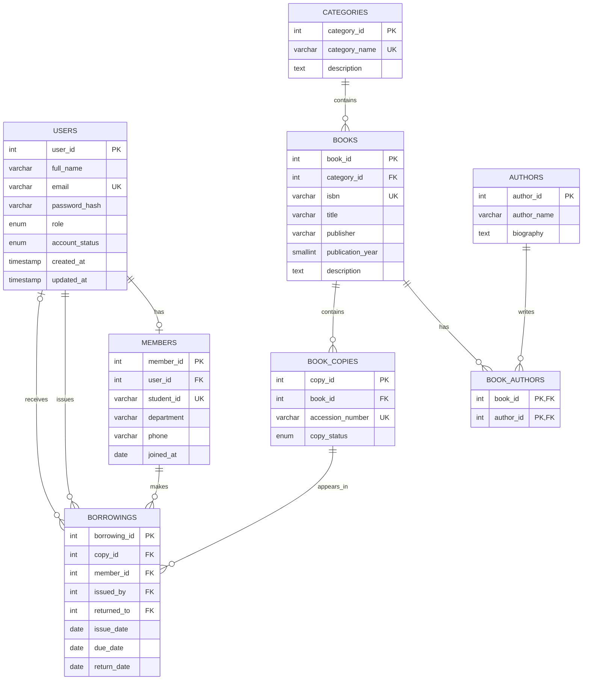

# Entity Relationship Diagram

The following diagram represents the initial logical
database design.

## Notes

- PK means Primary Key.
- FK means Foreign Key.
- UK means Unique Key.
- A book can have multiple physical copies.
- A book can have multiple authors.
- A member can borrow different copies over time.
- A physical copy can have only one active borrowing.

This is the initial logical model. The final SQL schema
will define data types, indexes, constraints, and deletion
rules explicitly.
